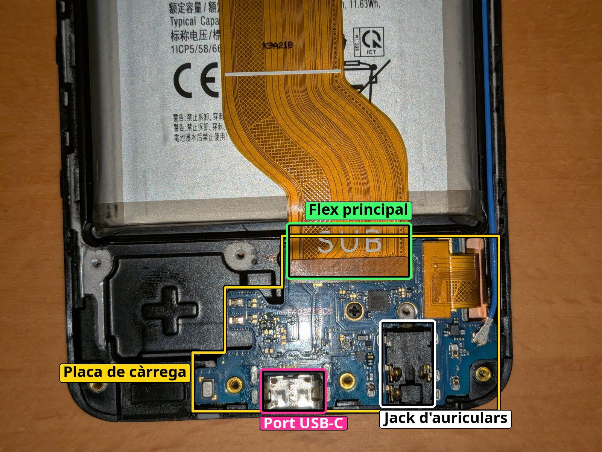
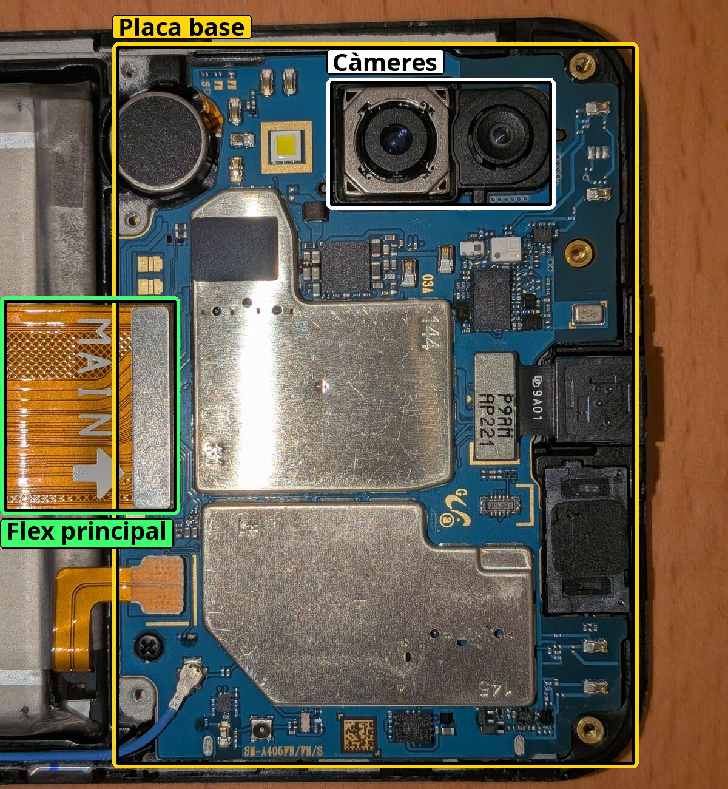
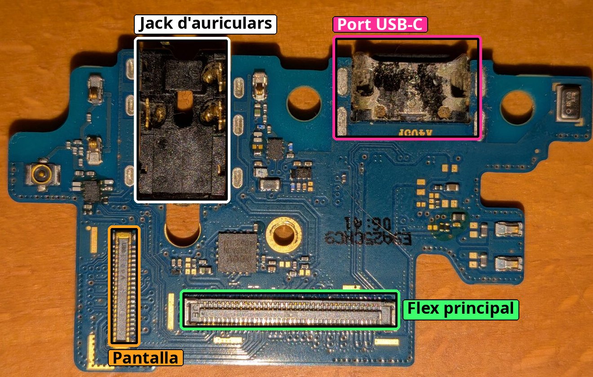
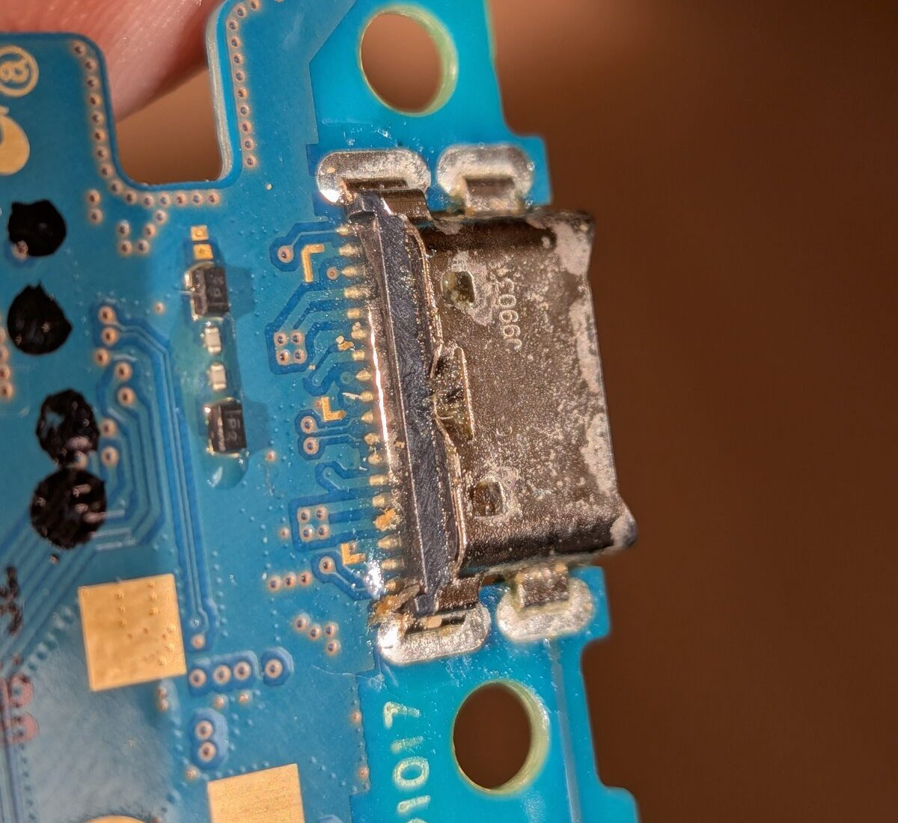

En aquest blog ens preguntem per què els mòbils duren tan poc si tècnicament podrien durar molt més. Jo en tenia un cas a casa: el meu Samsung Galaxy A40, que feia un parell de mesos que no s'encenia. Així que vaig decidir obrir-lo i veure en primera persona fins a quin punt es pot reparar un mòbil normal i corrent, a casa i amb quatre eines.

::: {.callout-note appearance="simple"}
## La reparació en xifres

- Mòbil: Samsung Galaxy A40, comprat el 2019.
- Avaria: no carregava (port USB-C corroït i bateria esgotada).
- Solució: netejar la placa de càrrega amb etanol, sense canviar cap peça.
- Despesa: uns 30 € en tornavisos, que aprofitaré per a altres reparacions. La placa nova costava entre 6 i 15 €.
- Temps: gairebé 3 hores de feina, més unes hores de càrrega.
- Guia: la d'iFixit, escrita per la comunitat i incompleta.
:::

## Set anys de vida

Vaig comprar el Galaxy A40 el 2019, just quan va sortir, i en aquests set anys ha tingut una vida dura però bona.

Amb el temps s'anava alentint i algunes coses començaven a fallar. Primer el botó de baixar el volum i després el de pujar-lo. No em va preocupar gaire, perquè normalment el tinc en silenci, i a més vaig instal·lar [Edge Seek](https://apt.izzysoft.de/fdroid/index/apk/lsafer.edgeseek), una aplicació de codi obert que permet pujar i baixar el volum (i la brillantor!) lliscant el dit per les vores de la pantalla [@oboody2025]. De vegades és força còmode suplir una funció del _hardware_ amb _software_.

Després va fallar el lector d'empremtes, però gairebé no el feia servir. La tapa posterior també es va acabar desenganxant, cosa que amb una funda tampoc es nota gaire. I les aplicacions anaven cada cop més lentes: el mòbil s'havia quedat a Android 11 i ja no rebia actualitzacions de seguretat.

Res d'això em va fer comprar-ne un de nou, en part per estima i en part perquè, un cop t'hi acostumes, de debò que no es nota gaire. La gota que va fer vessar el got va ser una caiguda anant en bici: la pantalla va començar a fer mal contacte (les típiques línies verdes) i, el més greu de tot, el mòbil ja no carregava. Quan me'n vaig adonar, vaig treure'n de seguida tots els arxius importants i em vaig passar a un altre mòbil. L'A40 va esgotar la bateria en poc temps i es va apagar del tot.

| Component | Què li va passar | Com m'hi vaig apanyar | Després de la reparació |
|---|---|---|---|
| Botó de baixar volum | Va deixar de funcionar | App per lliscar per la vora | Segueix espatllat |
| Botó de pujar volum | Va deixar de funcionar | App per lliscar per la vora | Segueix espatllat |
| Lector d'empremtes | Va deixar de funcionar | Gairebé no el feia servir | Funciona |
| Tapa posterior | Es va desenganxar | Funda | Segueix igual |
| Jack d'auriculars | Contacte irregular | Res | Fa bon contacte més sovint |
| _Software_ | Apps lentes, Android 11 sense pegats de seguretat | M'hi vaig acostumar | Més lent del que recordava |
| Pantalla | Línies verdes després de la caiguda | Cap: va ser el final | Sense línies |
| Càrrega | No carregava després de la caiguda | Cap: va ser el final | Carrega |

: Avaries de l'A40 al llarg de la seva vida i estat després de la reparació. Font: elaboració pròpia.

## La reparació

### Abans de començar

Tenia clar que el problema principal era la càrrega, així que vaig buscar guies per canviar el port. Vaig trobar la d'iFixit, que semblava prou fàcil [@ifixit2021]. La peça que s'hi canvia és tota la placa secundària, on hi ha el port USB-C, el micròfon i els connectors del flex principal i de la pantalla, i a eBay, Amazon, AliExpress i altres botigues en línia costava entre 6 i 15 euros.

Mig decidit, vaig pensar que valia més la pena obrir-lo i fer-hi una ullada abans de comprar res. El que sí que vaig haver de comprar va ser un joc de tornavisos de la mida correcta. Em vaig quedar amb el Mako d'iFixit, que havia vist molt recomanat i que em va costar uns 30 euros, més del que valia la peça. Això sí, el joc em servirà per a moltes altres reparacions; sense anar més lluny, ja tinc pensat fer-lo servir amb el meu portàtil antic.

### Obrir-lo

La guia l'ha escrita la comunitat, la marca com a fàcil i calcula uns 30 minuts, tot i que porta un avís de «Missing Steps»: hi falten passos. Jo hi tenia prou confiança, així que m'hi vaig posar. Resumits, els passos són aquests [@ifixit2021]:

1. Apagar el mòbil i desenganxar la tapa posterior, que va enganxada amb adhesiu. La guia fa servir una pistola de calor, una ventosa i alcohol isopropílic.
2. Treure la safata de la SIM i desconnectar el lector d'empremtes, que va a la tapa.
3. Treure els 13 cargols i el marc principal.
4. Desconnectar el flex principal, el de la pantalla i el cable de l'antena, i treure els cargols negres que subjecten la placa de càrrega.
5. Separar la placa del marc amb una eina de plàstic. La guia recomana escalfar-la una mica.

El primer pas me'l vaig poder estalviar, perquè la meva tapa ja queia sola. Descargolar-lo també va ser directe, amb el tornavís de la mida correcta, és clar. On em vaig encallar una mica va ser en treure el marc principal: no veia gaire clar per on havia d'estirar, ni a la guia ni al vídeo. Potser era perquè no tenia l'eina que recomanaven i només comptava amb els dits i les ungles, però al final em van bastar i per fi el vaig tenir obert del tot.

{width=70% fig-align="center"}

### La placa de càrrega

Treure la placa va ser el moment en què més vaig trobar a faltar una pistola de calor. Va una mica enganxada al marc, i em va costar separar-la amb delicadesa. Un assecador de cabells hauria fet el fet, però no en tenia cap a mà.

Un cop fora, la vaig inspeccionar a ull i no estava en el seu millor moment: tant el port USB-C com el jack d'auriculars tenien força corrosió, potser per la humitat que hi va poder entrar mentre la tapa estava desenganxada. En veure-la, vaig pensar que potser no calia canviar-la. Si en treia la corrosió, podria tornar a fer bon contacte i a carregar. Aquesta era la meva esperança.

{width=60% fig-align="center"}

Per netejar-la, com que no tenia alcohol isopropílic d'alta puresa, vaig fer servir etanol de 96°. Abans em vaig assegurar que cap dels seus additius deixés una pel·lícula no conductora en evaporar-se l'etanol, tal com recomanaven en una cerca ràpida per internet. Ho vaig netejar tot bé amb escuradents i bastonets de cotó amarats d'alcohol, i ho vaig deixar assecar una bona estona. Mentrestant, vaig aprofitar per comprovar que els connectors de la resta de la placa fessin bon contacte.

::: {.callout-tip collapse=true}
## Per què alcohol?

La crosta del port és corrosió: òxids i sals que es formen quan la humitat ataca el metall dels contactes. L'alcohol no la desfà, la crosta la treu el fregat amb l'escuradent i el bastonet. El que fa l'alcohol és ajudar a endur-se-la i deixar-ho tot net i sec.

La molècula d'etanol té una part semblant a l'aigua (el grup hidroxil, -OH) i una part semblant a un greix (la cadena de carbonis). Per això es barreja amb l'aigua en qualsevol proporció i alhora dissol greixos i restes orgàniques que l'aigua sola no treu. A més, la seva tensió superficial és més de tres vegades més baixa que la de l'aigua (uns 22 mN/m davant de 72, a 25 °C), de manera que mulla millor i s'escola entre els pins del port. També s'evapora de pressa: l'etanol bull a 78 °C i l'aigua a 100 °C [@pubchemetanol2026; @pubchemaigua2026]. I com que gairebé no condueix l'electricitat, es pot aplicar sobre un circuit sense risc, sempre que no tingui corrent.

L'isopropílic es recomana perquè es ven fàcilment al 99 %, amb molt poca aigua. L'etanol de 96° porta un 4 % d'aigua (96° vol dir un 96 % d'alcohol en volum), i aquesta aigua triga més a marxar. Per això convé deixar-lo assecar una bona estona.
:::

### El moment de la veritat

Un cop seca, la vaig tornar a muntar, ho vaig tancar tot i va arribar el moment de la veritat. Vaig connectar el mòbil al carregador i... res. No carregava.

Decebut però no rendit, vaig pensar que potser ara el problema era un altre. La bateria portava un parell de mesos al 0 %, i això pot fer que li costi acceptar càrrega: quan una bateria de liti es buida del tot, el seu circuit de protecció la desconnecta, i cal un corrent petit perquè es torni a activar [@batteryuniversity2021]. El que recomanaven per internet era deixar-lo connectat molta estona, perquè la bateria es carregués molt a poc a poc. Així ho vaig fer, i quan hi vaig tornar unes hores després, el mòbil s'havia il·luminat i marcava un 62 %!

::: {.callout-warning}
## Compte amb les bateries que han passat mesos a zero

Battery University desaconsella reactivar una bateria de liti que hagi passat una setmana o més per sota d'1,5 V per cel·la. A dins s'hi poden haver format ponts de coure que provoquin un curtcircuit, i la cel·la es pot escalfar en carregar-la [@batteryuniversity2021]. Mentre es recarrega una bateria així, cal vigilar que no s'escalfi ni s'infli.
:::

## Resultat

Vaig córrer a encendre'l i a revisar-lo. Tot sembla funcionar correctament, tot i que va més lent del que recordava. Quan el feia servir cada dia ja m'hi havia acostumat, i només ara, en tornar-hi, me n'adono.

A més, hi va haver sorpreses bones. El lector d'empremtes ara sí que funciona. Com que va a la tapa posterior, quan la tapa es va desenganxar se'n devia afluixar el connector, i en desconnectar-lo i tornar-lo a connectar seguint la guia ha quedat bé. La pantalla ja no fa línies verdes: el seu flex també va connectat a la placa de càrrega i el vaig haver de desconnectar, així que potser ara ha quedat més ben assentat. I el jack d'auriculars, després de la neteja, fa bon contacte de manera més constant.

Els botons de volum, això sí, segueixen igual. Potser és el següent que miraré d'arreglar o substituir.

## Què en penso de la reparabilitat de l'A40

Per a aquesta avaria, l'A40 m'ha semblat força reparable. El port de càrrega va en una placa separada de la placa base, subjecta amb uns cargols i connectada amb tres cables. Es pot treure, netejar o canviar sense tocar la resta del mòbil, i la peça nova és barata: entre 6 i 15 euros. Tampoc calen eines especials. A mi em van bastar un tornavís de la mida correcta i els dits, i el joc de tornavisos, tot i costar més que la peça, l'aprofitaré en altres reparacions.

Ara bé, hi ha coses que el fan més difícil. La tapa posterior va enganxada, i la guia la treu amb calor i una ventosa. Jo me'n vaig estalviar perquè ja havia caigut sola, però en un A40 sencer segurament seria la part més delicada. La placa de càrrega també va una mica enganxada, i sense calor costa separar-la amb delicadesa. I la informació és escassa: l'única guia que vaig trobar és de la comunitat, li falten passos i el del marc no s'entén.

La guia parla d'una reparació fàcil de 30 minuts. A mi, entre començar, anar buscant informació i esperar que s'assequés, se me'n van anar gairebé tres hores, sense comptar les hores de càrrega. És cert que la guia descriu un canvi de placa, i jo la vaig netejar i deixar assecar, que porta més estona.

On l'A40 ha quedat realment antic és en el _software_. Es va quedar a Android 11, sense _updates_ de seguretat, i les aplicacions hi van cada cop més lentes. Això no ho arregla cap neteja amb alcohol.

## I ara, què?

Ara que torna a funcionar, la idea és fer-lo servir per experimentar amb la part de _software_: rootejar-lo, provar LineageOS i coses per l'estil. Si me'n surto, potser li podré donar les actualitzacions que Samsung ja no li dona.

Aquesta experiència m'ha servit per proposar una [fitxa de criteris de reparabilitat](../fitxa-reparabilitat/) pensada per als mòbils que arriben com a donació a VINCLE DIGITAL.
