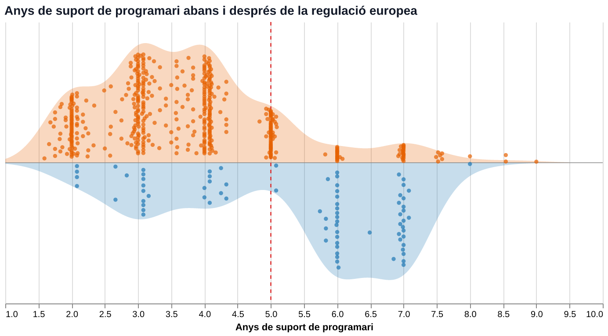

## Introducció: La mort dels mòbils

Sovint fem servir la frase "se m'ha mort el mòbil" per indicar que el mòbil ha deixat de funcionar. Això pot ser degut a una caiguda que ha trencat la pantalla en mil bocins, o degut a un port de càrrega que ha arribat al final de la seva vida útil, o al fet que el tàctil de la pantalla sigui inutilitzable. Tot aquests problemes causen una mort evident i directa del dispositiu, perquè, a menys que el hardware compromès sigui reparat o reemplaçat, el dispositiu deixa de ser utilitzable com ho era abans. Aquesta però no és l'única manera de la qual pot "morir" un dispositiu electrònic. De vegades, un aparell en perfectes condicions físiques, deixa de poder usar-se en plenes condicions després d'actualitzacions recents, o inclús, sense nosaltres adonar-nos-en, deixa de rebre actualitzacions de seguretat i passa a ser vulnerable a atacs per la xarxa.

La majoria d'usuaris canvien de mòbil quan aquest encara funciona físicament. A la Unió Europea la vida mitjana de primer ús ronda els 2-3 anys [@canvi_smartphonesJRC116106; @su17136160]. Però quin paper juga exactament el programari en aquest cicle? És una decisió tècnica inevitable o una forma d'obsolescència?

Al llarg d'aquest article explorarem com afecta el programari en la durabilitat efectiva dels telèfons mòbils, tan des de la perspectiva d'actualitzacions de seguretat, com de la perspectiva d'obsolescència i suport del programari.

## 1. Quan deixa d'actualitzar-se el programari?

Fins fa molt poc, la vida d'un telèfon venia marcada pel calendari de suport del fabricant i no pas per la resistència dels seus components. Segons l'estudi de NDSS 2024 sobre milers de dispositius [@uluagac2024], veiem com, així com Apple ja fa temps que ofereix entre 5 i 7 actualitzacions d'iOS, la gran majoria de dispositius Android ni s'apropen a aquests nombres. la durada mitjana del suport tècnic varia dràsticament segons la gamma del dispositiu, oscil·lant entre els 570 i els 1.040 dies (és a dir, entre 1,5 i menys de 3 anys), especialment en gammes mitjanes i d'entrada. L'estudi també quantifica com s'acumulen centenars de vulnerabilitats conegudes en els mesos i anys posteriors a la fi del suport, deixant milions de dispositius mòbils vulnerables a atacs.

Un altre estudi de Farhang, Grossklags et al. [@farhang2020] investiga els retards en la distribució de *patches* per a Android després que es descobreixin escletxes. L'article, després d'analitzar 3171 vulnerabilitats CVE, descobreix que, així com empreses com Huawei aplicaven els *patches* sense retard en el 97% dels casos, fabricants com Samsung o LG presentaven retards en el 55.3% i 60.6% dels casos respectivament. També observen que la latència mediana de distribució és de 24 dies, als quals es sumen sovint 11 dies addicionals provocats per les operadores de xarxa abans que l'actualització arribi a través d'OTA (Over-The-Air). A més a més, Google retira el suport de versions d'Android antigues quan encara tenen una quota d'usuaris molt significativa.

## 2. Com "mor" un telèfon?

Quan un telèfon es queda sense suport de seguretat, s'enfronta a dos problemes diferents: L'acumulació de vulnerabilitats i l'obsolescència funcional d'aplicacions i certificats. L'article de Corrocher i Paganuzzi [@corrocher2025] explora evidència empírica al mercat italià sobre obsolescència planejada, i treu conclusions interessants a nivell de software sobre perquè canviem de dispositius. L'estudi observa una tendència de canvi en el consumidor europeu. S'observa que els cicles de renovació s'estan alentint i creix la demanda d'aparells que durin més anys i que ofereixin opcions més clares d'actualització i reparació. No obstant això, les autores destaquen que la manca d'actualitzacions i, principalment, la percepció d'alentiment del dispositiu continuen sent un dels principals desencadenants de la decisió de compra d'un nou terminal.

Un telèfon també pot morir d'una altra forma, l'anomenada "Obsolescència provocada". En l'article d'Hidalgo Cerezo [@hidalgocerezo2024] presenta aquest nou concepte d'obsolescència provocada, diferenciant-lo de la coneguda obsolescència programada. Es tracta de modificacions de programari posteriors a la compra que redueixen deliberadament o negligentment la velocitat, l'autonomia o la funcionalitat d'un bé. L'article defensa el dret del consumidor a poder tornar a versions anteriors del software, i fer explícita la informació de les actualitzacions que alentiran el funcionament del dispositiu. Aquesta obsolescència provocada, sumada a que els consumidors canvien de telèfon en grap part per culpa de l'alentiment d'aquest, ens porta a entendre que el software és un dels principals causants de la "mort" dels dispositius.

## 3. Reglament (UE) 2023/1670

Recentment, des del 20 de juny del 2025, la Unió Europea ha aprovat una llei per tal de apaivagar el creixent consumisme i evitar el malbaratament de dispositius en bon estat que són deixats en desús per culpa del sistema operatiu.

Des del 20 de juny de 2025 per tant, el Reglament d'ecodisseny (UE) 2023/1670 [@ue2023ecodisseny] obliga tots els fabricants que venen telèfons al mercat comunitari a:
1. Garantir com a mínim **5 anys d'actualitzacions de seguretat i del sistema operatiu** a partir de la fi de la comercialització del model.
2. Distribuir els pegats de seguretat en un termini màxim de **4 mesos** des de la seva publicació general.
3. Prohibir actualitzacions que empitjorin el rendiment del maquinari sense el consentiment explícit de l'usuari.

Tot i que aquesta regulació és un gran pas per als telèfons nous, no resol la situació dels milions de dispositius ja fabricats que es troben actualment circulant o als calaixos de les llars. A més a més, segons un estudi fet conjuntament per Right to Repair Europe i iFixit el 2026 [@repaireu2026], on inspeccionen les fitxes tècniques de 2334 models de smartphones introduïts al mercat europeu durant l'últim any, no s'està complint la normativa europea. L'estudi evidencia un incompliment massiu de la normativa, el 80% dels telèfons analitzats encara no tenien la informació legalment exigida sobre instruccions de reparació o preus dels recanvis. A més a més, destaca que la gairebé la meitat dels fabricants deixaven camps buits o feien promeses vagues respecte les actualitzacions de seguretat.

## Conclusions i Opinió

Hem pogut veure que molt sovint no està en les mans de l'usuari la decisió de poder seguir fent servir un dispositiu mòbil o retirar-lo i canviar-lo per un altre. Causes com l'alentiment del OS o la falta d'actualitzacions de seguretat influeixen notablement en aquestes decisions. A més, hi ha una important falta de consciència sobre aquesta manca de seguretat dels mòbils antics. Un estudi fet per Witch? i TechRadar [@which2020] ens revela en una enquesta a 15.283 usuaris adults que tot i que un terç dels enquestats conservaven el seu mòbil més de 4 anys, només un 7% d'aquests eren conscients que la gran majoria d'aquests dispositius ja no rebien suport oficial i que estan exposats a greus riscs de seguretat. Això és una altra prova que junt amb l'article de Corrocher i Paganuzzi [@corrocher2025], demostren que hi ha una part important de la població reticent a canviar dispositius perfectament funcionals que són vulnerables a atacs informàtics per culpa de la manca de suport dels seus dispositius per part dels fabricants.

Recentment vaig voler experimentar i provar d'utilitzar com a telèfon principal un Samsung GT-E1153, de fa prop de 20 anys, com a experiment propi envers l'addicció a les pantalles i la dependència que genera només tenir-les a prop. Tot i el dispositiu funcionar perfectament després de tants anys, la xarxa que utilitza, el 2G, està ja en avançat procés de desmantellament, i moltes de les companyies telefòniques ja no ofereixen servei 2G. I és que 20 anys semblen molts anys, perquè ja ens hem acostumat a aquest món d'immediatesa, on tot ha d'anar cada vegada més i més ràpid. Amb aquest experiment veiem com el maquinari pot sobrevioure físicament durant dècades, i quedar inutilitzable completament per culpa de l'apagada de la xarxa o actualitzacions de programari.

També observem com, tot i que la Unió Europea ha fet i segueix fent progrés cap a un millor suport dels telèfons mòbils, molts encara no compleixen la normativa, i la gran majoria d'usuaris segueixen tenint i utilitzant mòbils llançats abans d'aquesta normativa, i per tant que en pocs anys si no ja, deixaran de rebre actualitzacions de seguretat. No obstant això, sembla que la normativa està tenint algun efecte, i una quantitat considerable de dispositius ja ofereixen 5 o més anys d'actualitzacions.

És per això que cal ser conscients de la situació, i cal prendre mesures per tal de combatre-ho. Si volem fer servir un dispositiu mòbil de certa antiguitat, cal que siguem conscients dels riscs que comporta si el connectem a internet. D'una banda, un mòbil antic continua essent un dispositiu amb moltíssimes capacitats que poden seguir explotant-se sense accedir a internet, evitant així qualsevol ciberatac. D'altra banda, projectes com el de *LineageOS* [@lineageos2026dispositius] treballen activament a favor de la resurrecció de mòbils vells. Basant-se en AOSP (Android Open Source Project), desenvolupa i manté versions netes i actualitzades d'android per a centenars de models de telèfons descatalogats als que els fabricants han deixat de donar suport oficial. Amb això, aconsegueix mantenir versions modernes d'Android a models que van sortir al mercat fa entre 6 i 10 anys, allargant molt significativament la vida útil d'aquests dispositius. A més, aporten millores importants d'eficiència, tant energètica com de recursos de computació, recuperant també la degradació provocada per l'anomenada "obsolescència provocada" [@hidalgocerezo2024]. De cara al projecte Vincle Digital, on els mòbils han de conservar la capacitat de connectar-se a internet amb seguretat per als usuaris, iniciatives com *LineageOS* són claus per estendre aquest suport més enllà dels calendaris comercials.

