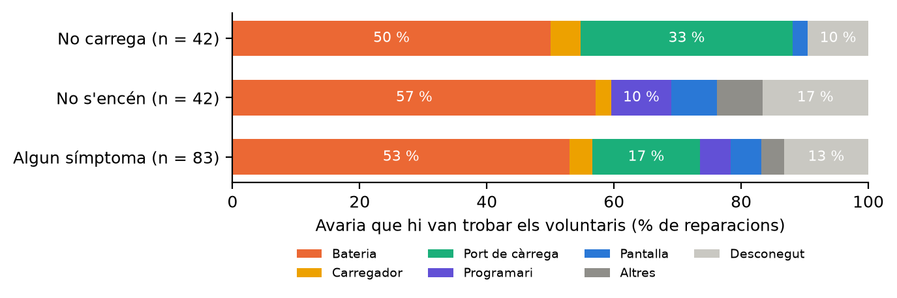
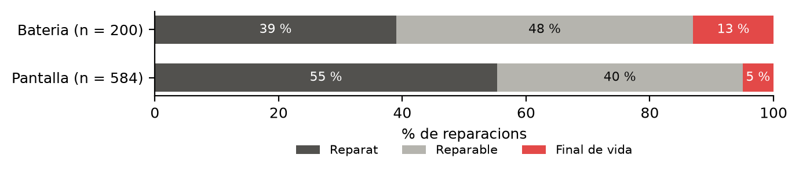

En entrades anteriors hem vist que un mòbil no deixa de servir només perquè s'espatlli: hi pesen [la percepció](../obsolescencia/), [el programari](../suport-programari/) i les dificultats per [arreglar-lo en un repair café](../repair-cafes/). Però hi ha una peça que, faci el que faci l'usuari, acaba fallant: la bateria. Cada cicle de càrrega li treu una mica de capacitat, i la calor o tenir-la sempre plena ho acceleren [@batteryuniversity2021]. També és l'única peça del mòbil amb un llindar legal de durabilitat: des del 20 de juny de 2025, ha de conservar el 80 % de la capacitat després de 800 cicles complets [@ue2023ecodisseny].

En aquesta entrada mirem tres coses. Quan un mòbil sembla que té la bateria morta, ho és de veritat? A quina edat falla la bateria a la pràctica, comparada amb el que exigeix el reglament? I per què, quan s'espatlla, costa més d'arreglar que una pantalla?

## D'on surten les dades

Fem servir les reparacions que registren els Repair Cafés i iniciatives semblants de diversos països i que publica l'Open Repair Alliance [@ora2026dades]. Dins d'aquestes dades hi ha **MobiFix**, un conjunt de reparacions de mòbils de fins al 2020 en què uns voluntaris van llegir cada registre i van anotar quina avaria era. Aquestes etiquetes, posades per persones, són la base de l'anàlisi.

| | Reparacions |
|---|---|
| Reparacions de mòbils de MobiFix amb descripció | 1.664 |
| ... amb un símptoma de bateria a la descripció | 114 |
| ... classificades com a avaria de bateria | 200 |
| ... de bateria i amb l'edat del mòbil | 52 |

: Elaboració pròpia a partir d'Open Repair Data, versió de juliol de 2026.

També hem fet servir un programa que classifica automàticament la resta de reparacions, fins al 2026, a partir del text. Aquestes xifres surten com a complement i les marquem com a **no validades**, perquè el classificador només s'ha pogut comprovar amb les dades de MobiFix.

::: {.callout-warning}
## Què diuen i què no diuen aquestes dades

Només hi surten mòbils que s'han espatllat i que algú ha portat a un repair café, i els smartphones són una part molt petita del que hi arriba. L'edat és la del dia de la reparació, no la del dia que la bateria va començar a fallar. I la bateria que es canvia perquè «dura poc», sense cap avaria, gairebé no hi arriba. Per tant, aquestes dades no diuen quant dura una bateria en general: diuen què passa amb les que arriben a reparar.
:::

## Quan diem «és la bateria», ho és?

Hem buscat a les descripcions els símptomes típics de bateria (que no carrega, que no s'encén, que dura poc o que s'ha inflat) i els hem comparat amb l'avaria que hi van trobar els voluntaris. Molts textos ja porten el diagnòstic («bateria canviada»), així que per no fer trampa ens hem quedat amb els que no diuen la paraula «bateria».

Dels mòbils que **no carregaven** (42), només la **meitat** tenien la bateria espatllada. En **un terç** dels casos el problema era el port de càrrega, i en un 5 % el carregador. Dels que **no s'encenien** (42), un 57 % eren la bateria, però un 10 % eren un problema de *software* i un 7 % la pantalla.

Que un mòbil no carregui, doncs, no vol dir que la bateria estigui morta. Sovint és una avaria més barata i fàcil d'arreglar, com un port brut o espatllat, que és exactament el que va passar amb el [Samsung Galaxy A40](../reparacio-samsung-a40/). Les mostres són petites i cal llegir-ho com un indici. A més, el símptoma «dura poc» gairebé sempre surt al costat de la paraula «bateria», així que aquest no l'hem pogut separar del diagnòstic.

## Quant aguanta una bateria a la pràctica?

L'edat mediana d'un mòbil que arriba a MobiFix amb una avaria de bateria és de **4 anys** (interval de confiança del 95 %: de 3,5 a 5 anys; 52 reparacions). La d'un mòbil amb la pantalla trencada és de 2,5 anys. Té sentit: la pantalla sol trencar-se per un cop, en qualsevol moment, i la bateria es va gastant.

Per comparar-ho amb el reglament cal un pas més, perquè el reglament parla de cicles i nosaltres tenim anys. No sabem quants cicles fa cada mòbil, així que hem fet servir tres escenaris: mig cicle complet al dia, tres quarts i un. Amb aquests supòsits, els 800 cicles del reglament equivalen a entre **2,2 i 4,4 anys**.

Segons l'escenari, entre un **33 % i un 77 %** de les bateries que arriben a MobiFix ho fan després d'aquests 800 cicles. Hi ha dues lectures possibles, i aquestes dades no permeten triar-ne cap:

- **Les bateries duren més del mínim legal.** És el que va trobar un estudi de camp amb bateries de mòbils i tauletes, que després de diversos anys i centenars de cicles encara conservaven força capacitat [@clemm2016].
- **La gent conviu anys amb una bateria degradada** abans de fer-hi res, i només la porta a reparar quan ja no aguanta.

El conjunt classificat automàticament, que arriba fins al 2026, apunta en la mateixa direcció i una mica més enllà. Hi surt una edat mediana de 5 anys (213 reparacions), que puja de 4 anys entre el 2013 i el 2019 a 5 anys entre el 2021 i el 2026. Les bateries inflades arriben encara més tard, amb una mediana de 6,5 anys, però només són 11 casos. Com que aquestes xifres no estan validades, les prenem com una pista, no com un resultat.

## Per què no s'arregla?

Una bateria espatllada acaba sense solució (a «final de vida») el **13 %** de les vegades, més del doble que una pantalla (5 %). I només el 39 % es reparen el mateix dia, davant del 55 % de les pantalles. Gairebé la meitat queden pendents, segurament perquè cal demanar la bateria nova. Al conjunt classificat, no validat, la diferència es manté: un 18 % de finals de vida davant d'un 9 %.

El que hem intentat saber és per què, i aquí les dades gairebé no responen. Dels 89 finals de vida de bateria que tenim, els voluntaris només n'han anotat el motiu en 32:

- peces massa cares (9);
- no es pot obrir (6);
- no hi ha peces (6);
- falta d'equipament (5);
- falta d'informació (4).

Hem llegit també les descripcions amb una classificació automàtica per paraules clau, i en el 75 % dels casos el text no diu per què no s'ha pogut arreglar. Quan ho diu, els motius més freqüents són que el problema no era la bateria (7 casos) i que la bateria estava inflada o vessada (6). Que el motiu no consti és, en si mateix, un resultat: amb aquests registres no es pot saber si el que falla és la peça, el disseny del mòbil o el temps dels voluntaris.

## Què diu la llei i què canviarà?

El reglament (UE) 2023/1670 no només demana 800 cicles amb el 80 % de capacitat. També obliga que l'usuari pugui canviar la bateria, amb una excepció: el fabricant pot reservar aquest canvi als reparadors professionals si la bateria conserva el 83 % després de 500 cicles i el 80 % després de 1.000, i si el mòbil és resistent a l'aigua i la pols (IP67) [@ue2023ecodisseny]. El mateix reglament recull que la millor tecnologia disponible ja arriba als 1.200 cicles.

A més, el reglament de bateries (UE) 2023/1542 exigeix bateries que pugui extreure l'usuari a partir del 18 de febrer de 2027 [@ue2023bateries]. Per als smartphones, però, manen els requisits del reglament d'ecodisseny [@comissio2025bateries]. És a dir, molts mòbils podran seguir sense una bateria que l'usuari canviï sol, sempre que sigui prou duradora.

Amb els nostres escenaris, 1.000 cicles són entre 2,7 i 5,5 anys. Si les bateries arriben a reparar cap als 4 o 5 anys, una bateria que compleixi l'excepció podria cobrir bona part de la vida del mòbil. El problema és el que hem vist a l'apartat anterior: quan finalment falla, canviar-la és més difícil que canviar una pantalla.

## I ara, què?

La bateria és la peça que posa més clara la tesi d'aquest blog: un mòbil no es jubila només per motius tècnics, però tampoc en té prou amb la bona voluntat. La bateria es gasta segur, sovint es confon amb avaries més barates i, quan s'espatlla, s'arregla pitjor que una pantalla. El reglament europeu apunta en la bona direcció, però exigeix durabilitat més que no pas facilitat per canviar-la.

Per a VINCLE DIGITAL, això té una conseqüència pràctica. Davant d'un mòbil donat que «no carrega», abans de donar la bateria per morta cal mirar el port. I quan sí que és la bateria, la [fitxa de reparabilitat](../fitxa-reparabilitat/) ja valora si es troba recanvi i si hi ha guia per canviar-la, que és justament on topen les reparacions dels repair cafés.

::: {.callout-note collapse="true"}
## Com ho hem fet

- **Dades.** Open Repair Data, versió de juliol de 2026, filtrada a smartphones amb resultat conegut (5.652 reparacions). MobiFix aporta les etiquetes d'avaria posades per persones fins al 2020.
- **Símptomes (primer apartat).** Paraules clau en anglès, alemany, neerlandès, francès, castellà i danès. Només MobiFix. El quadern mostra 30 textos per comprovar a mà que les paraules clau funcionen; aquesta comprovació també està pendent.
- **Edat (segon apartat).** Mediana amb interval de confiança per *bootstrap* agrupat per grup de reparació (1.000 repeticions). Els cicles es converteixen en anys amb escenaris de 0,5, 0,75 i 1 cicle complet al dia, que són supòsits nostres.
- **Classificador (complement).** Regressió logística sobre fragments de text [@pedregosa2011], entrenada amb MobiFix. F1 macro de 0,76 en validació creuada. No validat fora de MobiFix.
- **Motius (tercer apartat).** Precodificació automàtica per paraules clau. Està pendent que una persona del grup revisi els 89 textos de final de vida.
- **Codi.** Quaderns a la carpeta `_analisi/notebooks/` d'aquesta entrada. Les dades d'Open Repair tenen llicència CC BY-SA 4.0.
:::
